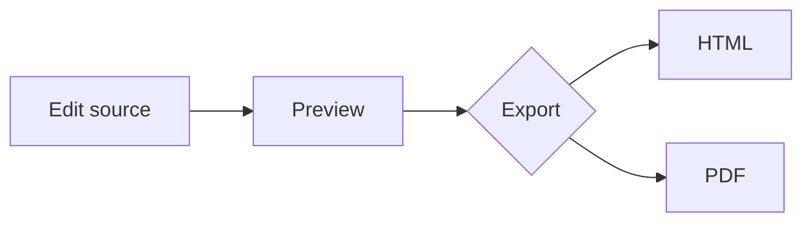

# Mdy Help

Mdy is a Markdown viewer and editor that opens with a double-click in Finder. The **source** is on the left and the **preview** is on the right.

> [!TIP]
> This document is an example. Compare the source and the preview. Editing it doesn't affect the app.

[TOC]

## Window

| Action | How |
|:--|:--|
| Source only / side by side / preview only | ⌘1 / ⌘2 / ⌘3, pane buttons at both ends of the toolbar |
| Source : preview ratio 1:3 / 1:1 / 3:1 | Ratio buttons in the toolbar, ⌥⌘1 / ⌥⌘2 / ⌥⌘3 |
| Resize panes | Drag the divider (drag to the edge to collapse, double-click for 1:1) |
| Sidebar (outline · files · search) | ⌃⌘S or the sidebar button on the left of the toolbar |
| Status bar (line/column, words, characters, changed lines) | ⌘/ |
| Line numbers · changed lines · focus mode (⇧⌘J) · typewriter scrolling | **View** menu |
| Fold / unfold headings | Click ▾ left of the source, ⌥⌘← / ⌥⌘→, all: ⌃⌥⌘← / ⌃⌥⌘→ |
| Sync scrolling | ⌥⌘L or the toolbar button |
| Zoom in / out / actual size | ⌘= / ⌘- / ⌘0 |
| Find (source and preview) | ⌘F, next ⌘G, previous ⇧⌘G |
| Start window (recent documents, templates) | **Go → Start Window**, right-click the Dock icon |

### Position highlight and sync scrolling

- Put the cursor in the source or select text, and the same part of the preview is highlighted in blue (the selected text in yellow).
- Click or select in the preview, and the matching source line is highlighted.
- With sync scrolling on, scrolling either side moves the other.

## Editing

There are two ways to edit.

- Edit the **source on the left** directly.
- **Double-click** a spot in the **preview on the right** → that block (paragraph, heading, list item, table, code…) turns into a Markdown box. What you type goes straight into the source. Press **⌘↩** or click outside when done; **esc** cancels. Tab indents.
- **⌥ double-click** in the preview jumps to that spot in the source. You can also tick checklist boxes right in the preview.

Edits are **saved automatically**, and ⌘S saves right away. ⌘Z undoes; to go back to an earlier state, use **File → Revert To**.

| Format | Shortcut |
|:--|:--:|
| **Bold** | ⌘B |
| *Italic* | ⌘I |
| ~~Strikethrough~~ | ⇧⌘X |
| ==Highlight== | ⇧⌘H |
| `Code` | ⇧⌘K |
| [Link](https://example.com) | ⌘K |
| Heading 1–6 / body text | ⌃⌘1–6 / ⌃⌘0 |

- Press **Return** in a list to continue it; Return on an empty item ends the list.
- **Tab / ⇧Tab** on a list line indents or outdents it.
- **Paste or drop images** to save them in an `images` folder next to the document and insert ``. (Save the document first.)
- Typing `(`, `[` or `` ` `` adds the closing mark; typing `*` `_` `~` `(` with text selected wraps it.
- In Settings (⌘,) you can change the font, coloring, spell check, auto-continue, auto-close and the image folder name.

### Tables

| Action | How |
|:--|:--|
| Next cell / previous cell | Tab / ⇧Tab (Tab in the last cell adds a row) |
| New row below | Return (Return on an empty last row leaves the table) |
| Align columns | ⇧⌘T (also automatic on Tab and Return) |
| Insert table, add or delete rows and columns | **Format → Table** |

### Pasting

- Bold, lists, tables and links copied from **the web, Google Docs, Word or Notes** come in as Markdown. Paste without formatting with **⌥⇧⌘V**.
- Cells copied from **Excel or Numbers** become a Markdown table.
- **Paste a URL with text selected** to make a `[text](url)` link.

### Copying to other apps

- **⌘C** in the preview keeps formatting when you paste into Mail, Slack or Notion.
- **Edit → Copy as Rich Text** (⌥⇧⌘C): copies the selected source (or the whole document) with formatting.
- The **Copy** button at the top right of code blocks in the preview copies just the code.

## Several documents

- Pick documents in **Sidebar → Files**. They open as tabs in one window (you can turn this off in Settings).
- **Sidebar → Search** (⇧⌘F): searches the contents of every document in the folder; click a result to jump to that line.
- Choose a workspace with **File → Open Folder…** to see that folder whichever document you open.
- **Open Quickly** (⇧⌘O): open a file by typing a few letters of its name.
- Click a `[another document](other.md)` link in the preview to open it (`other.md#heading` goes to that heading), and use **⌘[ / ⌘]** to go back and forward.
- When another app (git, another editor) changes the file, Mdy reloads it. If you also have unsaved edits, a bar at the top lets you choose.
- Colors left of the source: green added · blue modified · red deleted. Documents in a git repository are compared with the last commit, others with the document as it was when opened.

### Templates

- **File → New from Template**: start from meeting notes, a journal, a to-do list or a draft post. `{{date}}` `{{time}}` `{{weekday}}` in a template are filled in when the document is created.
- Add your own with **Save as Template…**, and edit or delete them in **Open Templates Folder**.

## Exporting

- **File → Export as HTML…** (⇧⌘E): a single HTML file with styles
- **File → Export as PDF…** (⌥⌘P), **Print…** (⌘P)
- **File → Export as Word… / Export as RTF…**: a formatted document. Math becomes TeX text and diagram images are left out.

## Supported syntax

1. Headings, paragraphs, line breaks
2. Lists and checklists
   - [x] Done
   - [ ] To do
3. Tables, quotes, rules, HTML

```swift
// Code blocks are colored by language
struct Greeting {
    let name: String
    func message() -> String { "Hello, \(name)!" }
}
```

```python
def fib(n: int) -> int:
    return n if n < 2 else fib(n - 1) + fib(n - 2)  # Fibonacci
```

Write math with `$...$` and `$$...$$`: $e^{i\pi} + 1 = 0$

$$
\sum_{k=1}^{n} k = \frac{n(n+1)}{2}
$$

Draw diagrams with a `mermaid` code block.



Footnotes work too.[^1] Write `[TOC]` on its own line to insert a table of contents there (like at the top of this document).

> [!NOTE]
> Math (KaTeX) and diagrams (Mermaid) are built into the app, so they render offline.

> [!WARNING]
> There are five GitHub-style alerts: `> [!NOTE]`, `[!TIP]`, `[!IMPORTANT]`, `[!WARNING]`, `[!CAUTION]`.

## Quick Look in Finder

Select a `.md` file in Finder and press the **Space bar** to preview it in Mdy's style.

## Safety and privacy

- The preview doesn't run scripts inside documents.
- If a preview link points to an executable (an app, a script…), Mdy doesn't open it, and it asks before opening addresses that launch other apps.
- Turn on **Settings → Preview → Block remote images** to stop loading images from web addresses right away, so the sender can't tell you opened the document.
- **What information is sent?** Only one request to the public GitHub API asking for the latest release when checking for updates. Document contents are never sent anywhere. Turn off automatic checks in Settings to stop that too. (Remote images load from wherever the document points unless you block them.)

[^1]: Footnotes collect at the bottom of the document. Click ↩ to go back to the text.
