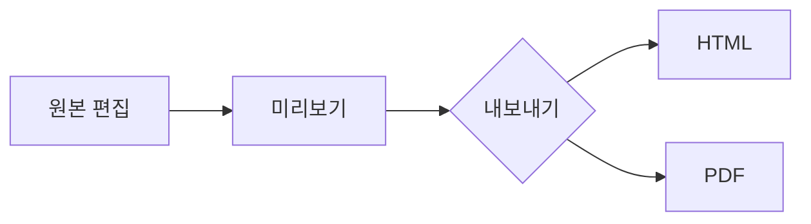

# Mdy 도움말

Mdy는 Finder에서 더블클릭으로 여는 마크다운 뷰어 겸 편집기예요. 왼쪽은 **원본**, 오른쪽은 **미리보기**예요.

> [!TIP]
> 이 문서 자체가 예제예요. 왼쪽 원본과 오른쪽 미리보기를 비교해 보세요. 고쳐도 앱에는 영향이 없어요.

[TOC]

## 화면

| 동작 | 방법 |
|:--|:--|
| 원본만 / 나란히 / 미리보기만 | ⌘1 / ⌘2 / ⌘3, 툴바 양 끝 패널 버튼 |
| 원본 : 미리보기 비율 1:3 / 1:1 / 3:1 | 툴바 비율 버튼, ⌥⌘1 / ⌥⌘2 / ⌥⌘3 |
| 패널 폭 직접 조절 | 가운데 구분선 끌기 (끝까지 밀면 접힘, 두 번 클릭하면 1:1) |
| 사이드바 (목차 · 파일 · 검색) | ⌃⌘S 또는 툴바 왼쪽 사이드바 버튼 |
| 상태 막대 (줄·열, 단어·글자 수, 바뀐 줄 수) | ⌘/ |
| 줄 번호 · 바뀐 줄 표시 · 집중 모드(⇧⌘J) · 타자기 스크롤 | **보기** 메뉴 |
| 제목 접기 / 펴기 | 원본 왼쪽 ▾ 클릭, ⌥⌘← / ⌥⌘→, 모두: ⌃⌥⌘← / ⌃⌥⌘→ |
| 스크롤 동기화 | ⌥⌘L 또는 툴바 버튼 |
| 확대 / 축소 / 실제 크기 | ⌘= / ⌘- / ⌘0 |
| 찾기 (원본·미리보기 모두) | ⌘F, 다음 ⌘G, 이전 ⇧⌘G |
| 시작 창 (최근 문서·템플릿) | **이동 → 시작 창**, Dock 아이콘 오른쪽 클릭 |

### 위치 표시와 스크롤 동기화

- 원본에 커서를 두거나 글자를 고르면, 미리보기의 같은 부분이 파랗게(고른 글자는 노랗게) 표시돼요.
- 반대로 미리보기를 클릭하거나 고르면 원본의 그 줄이 표시돼요.
- 스크롤 동기화가 켜져 있으면 어느 쪽을 스크롤해도 다른 쪽이 따라와요.

## 편집

고치는 방법은 두 가지예요.

- **왼쪽 원본**에서 바로 고치기
- **오른쪽 미리보기**에서 고칠 곳을 **두 번 클릭** → 그 블록(문단·제목·목록 항목·표·코드 등)이 마크다운 입력 칸으로 바뀌어요. 입력하는 대로 원본에 들어가고, **⌘↩**이나 바깥을 클릭하면 끝, **esc**는 취소예요. Tab은 들여쓰기예요.
- 미리보기에서 **⌥ 두 번 클릭**하면 원본의 그 자리로 가요. 체크리스트 상자는 미리보기에서 바로 눌러도 돼요.

고친 내용은 **자동 저장**되고 ⌘S로 바로 저장할 수도 있어요. ⌘Z로 되돌리고, 예전 상태로 돌아가려면 **파일 → 복귀**를 써요.

| 서식 | 단축키 |
|:--|:--:|
| **굵게** | ⌘B |
| *기울임* | ⌘I |
| ~~취소선~~ | ⇧⌘X |
| ==형광펜== | ⇧⌘H |
| `코드` | ⇧⌘K |
| [링크](https://example.com) | ⌘K |
| 제목 1~6 / 본문 | ⌃⌘1~6 / ⌃⌘0 |

- 목록에서 **Return**을 누르면 다음 항목 기호가 붙고, 빈 항목에서 Return을 누르면 목록이 끝나요.
- 목록 줄에서 **Tab / ⇧Tab**으로 들여쓰기·내어쓰기 해요.
- 이미지를 **붙여 넣거나 끌어다 놓으면** 문서 옆 `images` 폴더에 저장하고 ``를 넣어요. (먼저 문서를 저장해야 해요.)
- `(`, `[`, `` ` ``를 치면 닫는 기호가 붙고, 글자를 고른 채 `*` `_` `~` `(` 등을 치면 그 기호로 감싸요.
- 설정(⌘,)에서 글꼴, 색칠, 맞춤법 검사, 자동 이어쓰기, 짝 맞추기, 이미지 폴더 이름을 바꿀 수 있어요.

### 표

| 동작 | 방법 |
|:--|:--|
| 다음 칸 / 이전 칸 | Tab / ⇧Tab (마지막 칸에서 Tab은 새 행) |
| 아래에 새 행 | Return (마지막 빈 행에서 Return은 표에서 나가기) |
| 세로줄 맞추기 | ⇧⌘T (Tab·Return 때도 자동) |
| 표 넣기, 행·열 추가·삭제 | **서식 → 표** |

### 붙여 넣기

- **웹·구글 문서·워드·메모**에서 복사한 굵게·목록·표·링크는 마크다운으로 바뀌어 들어가요. 서식 없이 붙이려면 **⌥⇧⌘V**.
- **엑셀·넘버스**에서 복사한 칸은 마크다운 표가 돼요.
- 글자를 고른 채 **주소를 붙여 넣으면** `[글자](주소)` 링크가 돼요.

### 다른 앱으로 복사

- 미리보기에서 **⌘C** 하면 메일·슬랙·노션에 붙여 넣어도 서식이 그대로예요.
- **편집 → 서식 있는 텍스트로 복사** (⌥⇧⌘C): 원본에서 고른 부분(없으면 문서 전체)을 서식째 복사해요.
- 미리보기의 코드 블록 오른쪽 위 **복사** 단추로 코드만 복사해요.

## 여러 문서

- **사이드바 → 파일**에서 폴더 안 문서를 골라요. 문서는 한 창의 탭으로 열려요(설정에서 끌 수 있어요).
- **사이드바 → 검색** (⇧⌘F): 폴더 안 모든 문서의 내용에서 찾고, 결과를 누르면 그 줄로 가요.
- **파일 → 폴더 열기…**로 작업 폴더를 정하면, 어떤 문서를 열어도 그 폴더가 보여요.
- **빠른 열기** (⇧⌘O): 파일 이름 몇 글자로 바로 열어요.
- 미리보기에서 `[다른 문서](other.md)` 링크를 누르면 그 문서가 열리고(`other.md#제목`이면 그 제목으로), **⌘[ / ⌘]**로 뒤로·앞으로 가요.
- 다른 앱(git, 다른 편집기)에서 파일이 바뀌면 자동으로 다시 불러와요. 이쪽에도 저장 안 된 수정이 있으면 위쪽에 고를 수 있는 막대가 떠요.
- 원본 왼쪽 색 표시: 초록 추가 · 파랑 수정 · 빨강 삭제. git 저장소의 문서는 마지막 커밋과, 아니면 문서를 연 때와 비교해요.

### 템플릿

- **파일 → 템플릿으로 새 문서**: 회의록·일지·할 일 목록·글 초안으로 시작해요. 템플릿 안의 `{{날짜}}` `{{시간}}` `{{요일}}`은 만들 때 바뀌어요.
- **이 문서를 템플릿으로 저장…**으로 나만의 템플릿을 더하고, **템플릿 폴더 열기**에서 고치거나 지워요.

## 내보내기

- **파일 → HTML로 내보내기…** (⇧⌘E): 스타일이 들어간 HTML 한 파일
- **파일 → PDF로 내보내기…** (⌥⌘P), **프린트…** (⌘P)
- **파일 → Word로 내보내기… / RTF로 내보내기…**: 서식이 있는 문서로. 수식은 TeX 글자로 바뀌고 다이어그램 그림은 빠져요.

## 지원하는 문법

1. 제목, 문단, 줄바꿈
2. 목록과 체크리스트
   - [x] 끝낸 일
   - [ ] 할 일
3. 표, 인용문, 구분선, HTML

```swift
// 코드 블록은 언어별로 색칠돼요
struct Greeting {
    let name: String
    func message() -> String { "안녕하세요, \(name)!" }
}
```

```python
def fib(n: int) -> int:
    return n if n < 2 else fib(n - 1) + fib(n - 2)  # 피보나치
```

수식은 `$...$`와 `$$...$$`로 써요: $e^{i\pi} + 1 = 0$

$$
\sum_{k=1}^{n} k = \frac{n(n+1)}{2}
$$

다이어그램은 `mermaid` 코드 블록으로 그려요.



각주도 쓸 수 있어요.[^1] 문서에 `[TOC]`라고 한 줄 쓰면 그 자리에 목차가 들어가요(이 문서 맨 위처럼).

> [!NOTE]
> 수식(KaTeX)과 다이어그램(Mermaid)은 앱에 들어 있어서 인터넷 없이 그려요.

> [!WARNING]
> GitHub 스타일 알림은 `> [!NOTE]`, `[!TIP]`, `[!IMPORTANT]`, `[!WARNING]`, `[!CAUTION]` 다섯 가지예요.

## Finder 훑어보기

Finder에서 `.md` 파일을 고르고 **스페이스 바**를 누르면 Mdy 스타일로 미리 보여요.

## 안전과 개인정보

- 미리보기는 문서 안의 스크립트를 실행하지 않아요.
- 미리보기의 링크가 실행 파일(앱, 스크립트 등)을 가리키면 열지 않고, 다른 앱을 여는 주소는 먼저 물어봐요.
- **설정 → 미리보기 → 외부 이미지 막기**를 켜면 인터넷 주소의 이미지를 바로 불러오지 않아요. 받은 문서를 열었다는 사실이 상대에게 알려지지 않게 해 줘요.
- **어떤 정보를 보내나요?** 업데이트 확인 때 GitHub 공개 API에 최신 릴리스를 묻는 요청 하나만 보내요. 문서 내용은 어디에도 보내지 않아요. 설정에서 자동 확인을 끄면 그것도 보내지 않아요. (외부 이미지는 막기를 켜지 않으면 문서가 가리키는 곳에서 불러와요.)

[^1]: 각주는 문서 맨 아래에 모여요. ↩를 누르면 본문으로 돌아가요.
